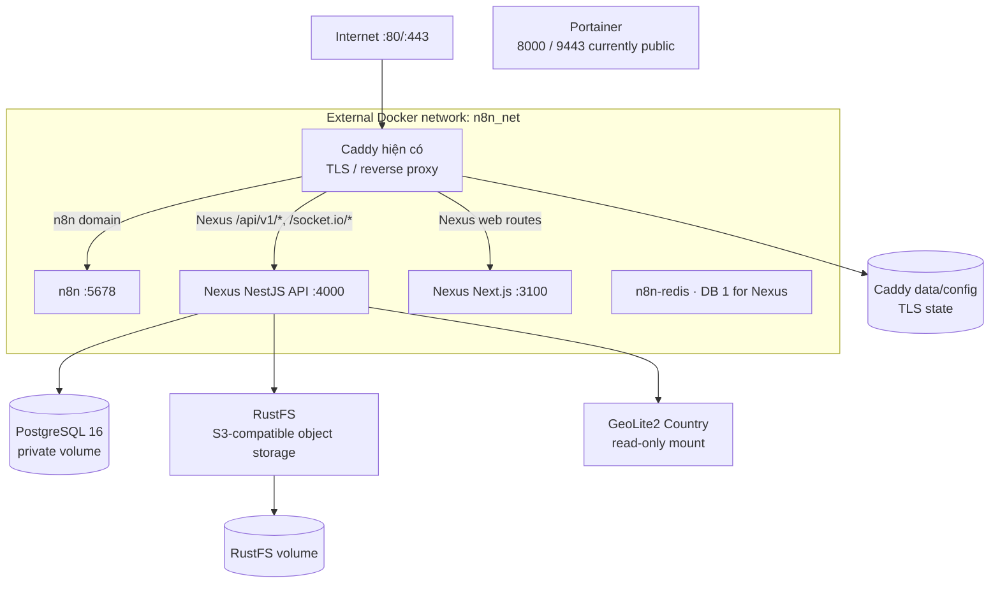

# VPS mới và triển khai Nexus ECM

VPS hiện tại: IP `160.191.89.92`, hostname `thuevpsgiare-1792644214`, Ubuntu 24.04 LTS, 4 vCPU, 7.8 GiB RAM, ổ đĩa 80 GiB (khoảng 67 GiB còn trống khi kiểm tra). Không sử dụng lại địa chỉ VPS cũ. Không lưu mật khẩu VPS vào tài liệu, file `.env` của ứng dụng hay Git.

## Đăng nhập SSH từ Windows

Mở PowerShell và kết nối bằng tài khoản quản trị ban đầu của VPS:

```powershell
ssh root@160.191.89.92
```

Nếu nhà cung cấp cấp username khác `root`, thay `root` bằng username đó. Lần đầu SSH hỏi xác nhận host key: chỉ nhập `yes` sau khi đối chiếu fingerprint với Virtualizor/nhà cung cấp. Nếu fingerprint khác hoặc chưa xác minh được, nhập `no` và dừng. Khi SSH hỏi password, nhập mật khẩu VPS tại dấu nhắc; ký tự không hiện khi gõ. Không thêm password vào câu lệnh.

Fingerprint SSH đã xác minh trong lần đăng nhập này: `SHA256:NDMdQ+DKq10Hr79B8rmO3SlLQQzt2I7pTQCKyh3dx9Y`.

Sau khi đăng nhập, xác nhận máy đích và xem tài nguyên bằng các lệnh chỉ đọc:

```bash
hostnamectl
cat /etc/os-release
uptime
nproc
free -h
df -h
docker --version
docker compose version
sudo ss -tulpn
sudo iptables -S
```

## Trạng thái triển khai trên VPS

- `hr.petshophanoi.com` đã phân giải về `160.191.89.92`.
- Source hiện tại ở `/opt/nexus-ecm`; production `.env` được tạo riêng trên VPS, quyền file `600` và không đưa vào Git.
- Compose project hiển thị trong Portainer với tên `nexus-ecm`. API, web, PostgreSQL và RustFS vẫn chạy thành các container riêng trong cùng stack. PostgreSQL có tên `nexus-ecm-postgres`.
- Nexus dùng Redis container `n8n-redis` hiện có trên `n8n_net`, với DB index `1`; n8n giữ DB mặc định. Redis riêng trước đây của Nexus đã được gỡ.
- Caddy hiện phục vụ `https://hr.petshophanoi.com`; API health trả `200`, trang `/dashboard` trả `200`. Cấu hình trước thay đổi được lưu bản sao cạnh Caddyfile.
- MinIO image không tải được từ registry trên VPS; storage đang chạy RustFS `1.0.7` qua S3-compatible API. API đã tự tạo bucket `nexus-files`.
- Country filtering được đặt tạm `GEOIP_COUNTRY_FILTER_ENABLED=false` theo yêu cầu; giới hạn đăng nhập sai và chặn IP vẫn hoạt động. Khi có file GeoLite2 Country được cấp phép, đặt biến thành `true`, mount file vào API container rồi rebuild/restart để bật lại giới hạn chỉ cho IP Việt Nam.

Máy chủ hiện đã có Docker 29.9.2/Compose 5.6.1 và một stack n8n. Không cài thêm Docker hoặc tạo Caddy thứ hai. Stack hiện tại: n8n, Redis, Caddy, Portainer; Caddy đang sở hữu cổng 80/443. Portainer publish 8000/9443 ra mọi địa chỉ; tôi xác nhận cả hai cổng đang truy cập được từ Internet. Hãy chặn chúng ở firewall nhà cung cấp hoặc giới hạn vào IP quản trị. UFW chưa được cài; chưa xác minh được firewall lớp nhà cung cấp.

Thông số VPS lúc kiểm tra: 4 vCPU; RAM 7.8 GiB; ổ đĩa 80 GiB; không có swap. Mức dùng RAM 835 MiB là số đo trước khi bật Nexus. Theo dõi RAM, CPU và dung lượng đĩa sau khi app bắt đầu được sử dụng.

Domain production là `hr.petshophanoi.com`. Site IP của VPS vẫn dùng `tls internal`; trình duyệt có thể không tin chứng chỉ khi truy cập bằng IP.

## 1. Chuẩn bị domain và VPS

Caddy tự xin TLS certificate. Cần một domain anh sở hữu trỏ bản ghi `A` về `160.191.89.92`; hostname nhà cung cấp `thuevpsgiare-1792644214` không thay thế domain công khai. Ví dụ dùng `hr.petshophanoi.com` nếu anh quản lý domain đó; cần tạo DNS A record trước. Nếu có bản ghi `AAAA`, nó cũng phải trỏ đúng VPS.

VPS đã có Docker nên không chạy lại trình cài Docker. Khi bảo trì hệ điều hành, sao lưu trước, cập nhật theo lịch và kiểm tra yêu cầu khởi động lại. Banner lúc kiểm tra báo 389 gói có bản cập nhật (223 bản cập nhật bảo mật tiêu chuẩn); không chạy nâng cấp tự động giữa giờ hoạt động.

```bash
sudo apt update
apt list --upgradable
```

UFW chưa được cài trên VPS. Cấu hình firewall trong Virtualizor/nhà cung cấp: chỉ cho SSH từ IP quản trị, 80/443 công khai, chặn 8000/9443 hoặc giới hạn chúng vào IP quản trị. Docker có thể tạo luật NAT riêng; đừng bật UFW khi chưa rà soát đường đi của các port publish. Không mở Postgres, Redis hay MinIO ra Internet.

Nếu dựng lại một máy Ubuntu mới, cài Docker theo hướng dẫn chính thức: <https://docs.docker.com/engine/install/ubuntu/>.

## 2. Lấy mã nguồn và cấu hình

```bash
sudo mkdir -p /opt/nexus-ecm
sudo chown "$USER":"$USER" /opt/nexus-ecm
git clone https://github.com/fsocietry/nexus-ecm.git /opt/nexus-ecm
cd /opt/nexus-ecm
cp .env.example .env
```

Tạo giá trị riêng, không dùng chung giữa các biến:

```bash
openssl rand -hex 24   # mật khẩu Postgres/MinIO
openssl rand -hex 32   # JWT access/refresh; chạy riêng cho từng khóa
openssl rand -hex 32   # FACE_ENCRYPTION_KEY
openssl rand -hex 16   # mật khẩu seed admin
```

Sửa `.env`. Giữ các biến hạ tầng khác theo `.env.example`, nhưng thay toàn bộ mật khẩu mẫu và đặt ít nhất các giá trị sau (thay domain mẫu bằng domain thật):

```dotenv
NODE_ENV=production
APP_DOMAIN=hr.petshophanoi.com
PROXY_NETWORK=n8n_net
API_URL=https://hr.petshophanoi.com
WEB_URL=https://hr.petshophanoi.com
NEXT_PUBLIC_API_URL=https://hr.petshophanoi.com/api/v1
CORS_ORIGIN=https://hr.petshophanoi.com
TRUST_PROXY_HOPS=1
GEOIP_COUNTRY_FILTER_ENABLED=false
```

Đặt `POSTGRES_PASSWORD`, `MINIO_ROOT_PASSWORD`, `JWT_ACCESS_SECRET`, `JWT_REFRESH_SECRET`, `FACE_ENCRYPTION_KEY` và mật khẩu seed admin thành giá trị vừa tạo (các biến tương ứng có trong `.env.example`). Đặt username seed admin khác `admin`, và thay email mặc định. Không dùng dấu `#`/khoảng trắng trong secret để tránh lỗi phân tích `.env`.

`TRUST_PROXY_HOPS=1` đúng với cấu hình này: Caddy hiện tại là proxy duy nhất đứng trước API. Không đặt API ở một địa chỉ công khai riêng.

## 3. Cài dữ liệu GeoIP Việt Nam

Đăng ký/tải cơ sở dữ liệu GeoLite2 Country từ MaxMind theo điều khoản của họ, rồi đưa file `GeoLite2-Country.mmdb` lên VPS tại:

```text
/opt/nexus-ecm/geoip/GeoLite2-Country.mmdb
```

Thư mục `geoip`/file này không được commit. Khi bật `GEOIP_COUNTRY_FILTER_ENABLED=true`, API cần file database và chỉ chấp nhận IP công cộng xác định thuộc Việt Nam. Khi false, kiểm tra quốc gia được bỏ qua; chặn IP và giới hạn sai mật khẩu vẫn hoạt động. IP nội bộ/loopback được bỏ qua để health check và mạng nội bộ hoạt động.

## 4. Khởi chạy

Sơ đồ Docker production hiện tại (Nexus API/web tham gia external network `n8n_net` để Caddy proxy; PostgreSQL/RustFS ở network private riêng):



Chỉ Caddy publish cổng web. API/web nối thêm vào `n8n_net` nhưng không publish host port; PostgreSQL và RustFS ở network mặc định riêng của Nexus, không publish cổng dữ liệu. Redis `n8n-redis` không bật mật khẩu và dùng chung trong `n8n_net`; Nexus dùng DB index 1 để tách keyspace khỏi n8n. Compose Nexus không chạy thêm Caddy. Stack `nexus-ecm` được Portainer nhóm chung, dù mỗi dịch vụ vẫn là một container riêng để quản lý health và khởi động độc lập. Portainer đang publish `8000/9443`; giới hạn truy cập quản trị ở firewall nhà cung cấp.

Kiểm tra cấu hình Compose trước khi bật dịch vụ:

```bash
cd /opt/nexus-ecm
sudo docker compose -f docker/docker-compose.prod.yml --env-file .env config -q
sudo docker compose -f docker/docker-compose.prod.yml --env-file .env up -d --build
```

Chạy migration một lần sau lần khởi động đầu tiên và sau mỗi bản cập nhật có migration mới:

```bash
sudo docker compose -f docker/docker-compose.prod.yml exec api \
  node packages/database/node_modules/.bin/prisma migrate deploy \
  --schema packages/database/schema.prisma
```

Domain `hr.petshophanoi.com` đã trỏ đúng VPS, có HTTPS hợp lệ và được thêm vào `/opt/stacks/n8n/Caddyfile`. Khi chỉnh file này, tạo bản sao lưu trước; nếu dùng `sed -i` thì khởi động lại Caddy để Docker bind mount nhận inode mới. Sau đó validate/reload qua container hiện có:

```bash
sudo docker compose -f /opt/stacks/n8n/docker-compose.yml exec caddy \
  caddy validate --config /etc/caddy/Caddyfile
sudo docker compose -f /opt/stacks/n8n/docker-compose.yml exec caddy \
  caddy reload --config /etc/caddy/Caddyfile
```

Giữ nguyên các site block n8n hiện tại; không khởi chạy thêm reverse proxy chiếm 80/443. DNS A của `n8n.petshophanoi.com` và `hr.petshophanoi.com` trỏ về `160.191.89.92`.

Kiểm tra dịch vụ và log nếu có lỗi:

```bash
sudo docker compose -f docker/docker-compose.prod.yml ps
sudo docker compose -f docker/docker-compose.prod.yml logs --tail=100 api
curl -fsS https://hr.petshophanoi.com/api/v1/health
```

Caddy tự cấp/gia hạn HTTPS khi DNS đã trỏ đúng và cổng 80/443 đến được từ Internet. API `/api/v1/*` và Socket.IO `/socket.io/*` được proxy đến API; các đường dẫn còn lại đến web. Nếu domain chưa sẵn sàng, Caddy sẽ chưa thể cấp certificate.

## 5. Sau khi cài

- Đăng nhập bằng tài khoản seed admin và đổi mật khẩu ngay; cấu hình domain ứng dụng trùng với `https://hr.petshophanoi.com` trong phần cài đặt.
- Thử đăng nhập sai 5 lần từ một IP thử nghiệm: IP bị giới hạn 1 giờ theo mặc định; admin có thể mở giới hạn, chặn thủ công hoặc đổi thời gian mở tự động trong phần bảo mật IP.
- Tạo bản sao lưu định kỳ PostgreSQL và RustFS; lưu bản sao ngoài VPS và thử phục hồi. VPS hiện chưa có swap; cân nhắc cấu hình 2–4 GiB swap nếu chạy đồng thời các stack và theo dõi RAM trước khi quyết định.
- Sau khi kiểm tra, đổi mật khẩu root đã dùng để đăng nhập; tạo và xác minh SSH key trước khi cân nhắc tắt đăng nhập bằng mật khẩu.
- Cập nhật phiên bản bằng `git pull`, build lại Compose, chạy migration nếu có, rồi kiểm tra health/log.

## Bảo mật hiện tại và việc nên nâng cấp

- Không có secret ứng dụng nào được chủ ý nhúng vào frontend; `NEXT_PUBLIC_API_URL` là địa chỉ công khai. Không đưa secret vào biến `NEXT_PUBLIC_*`.
- Access/refresh token hiện được lưu ở vùng JavaScript đọc được trên trình duyệt để hỗ trợ “ghi nhớ đăng nhập”. Nâng cấp đáng ưu tiên là chuyển sang cookie `HttpOnly`, `Secure`, `SameSite` qua backend-for-frontend, rồi bổ sung MFA bắt buộc cho admin.
- Tiếp theo: bật giám sát cảnh báo đăng nhập/audit, giới hạn quyền SSH bằng khóa và IP quản trị, tự động vá OS/dependency, kiểm tra phục hồi backup, và bổ sung CSP nghiêm ngặt sau khi rà soát tài nguyên frontend.
- API production tắt Swagger mặc định, bật Helmet, CORS allow-list, validation và hash mật khẩu. Các biện pháp này không thay thế cập nhật hệ điều hành, sao lưu và giám sát.
