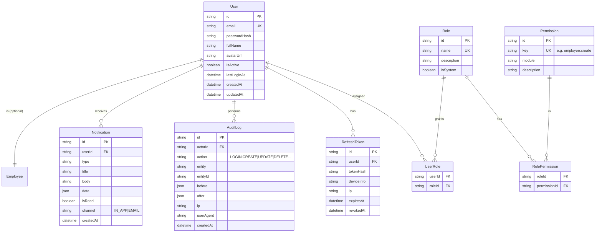
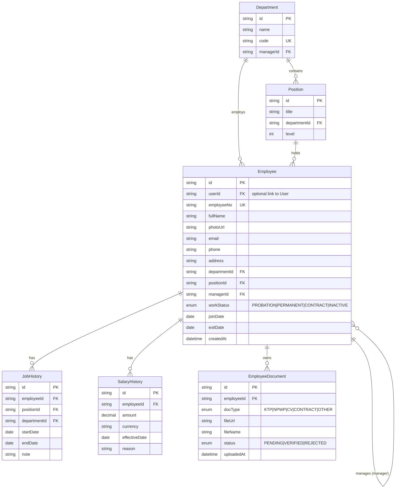
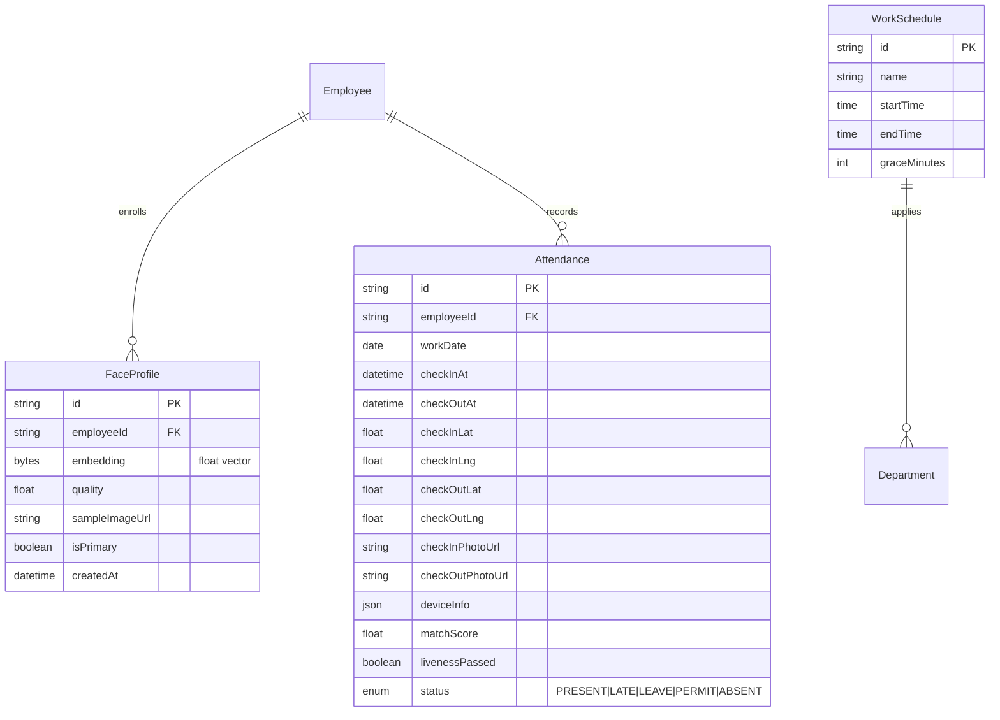
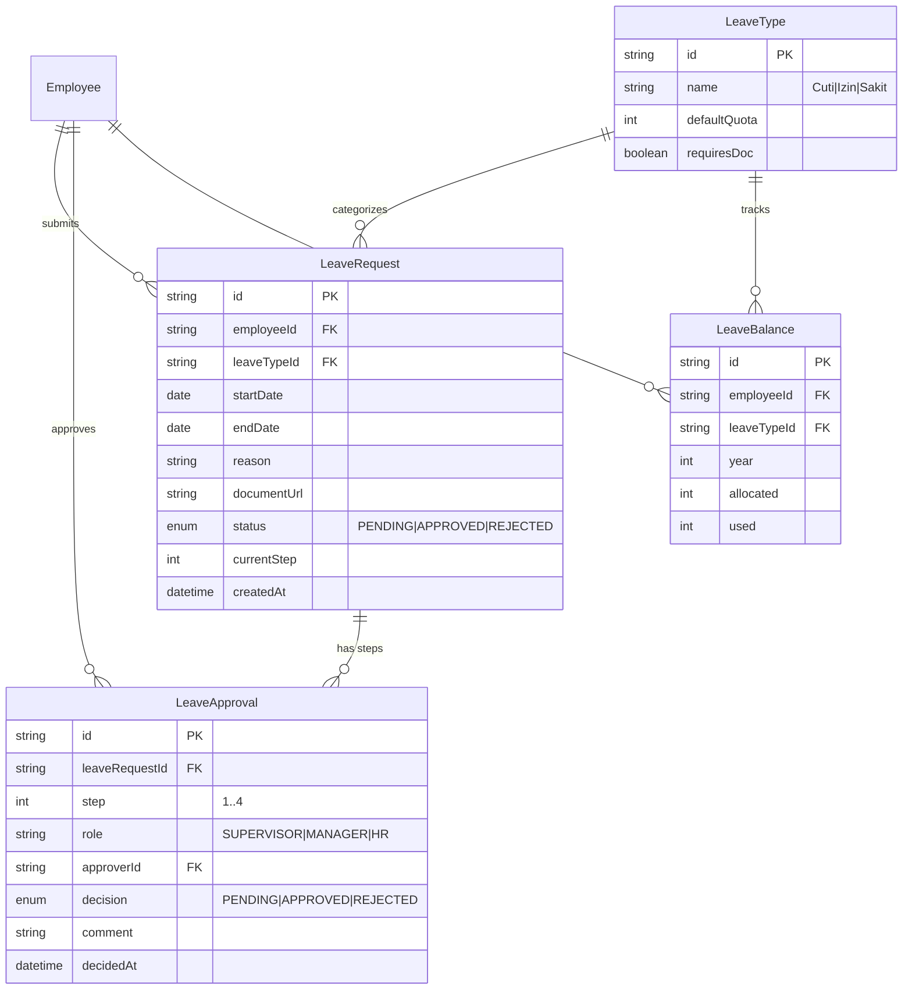
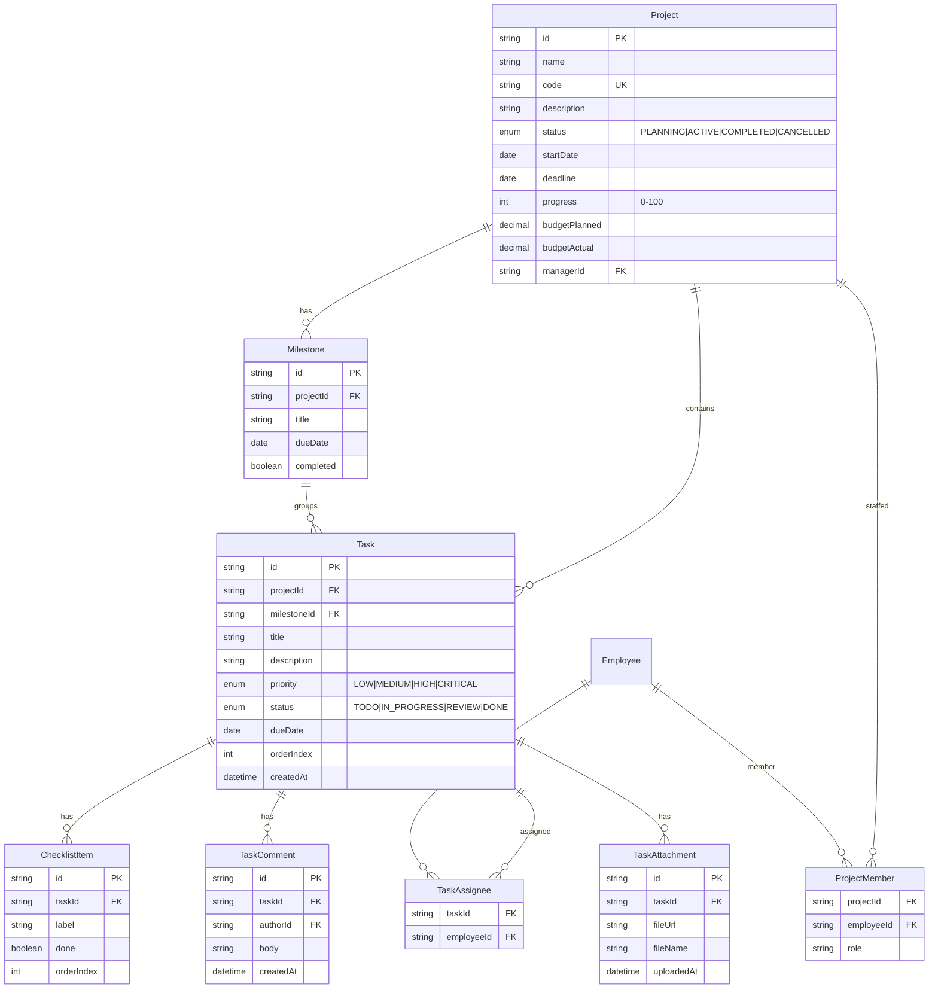
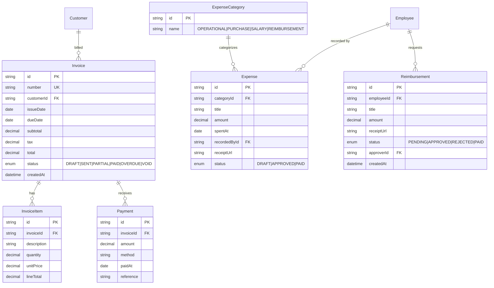
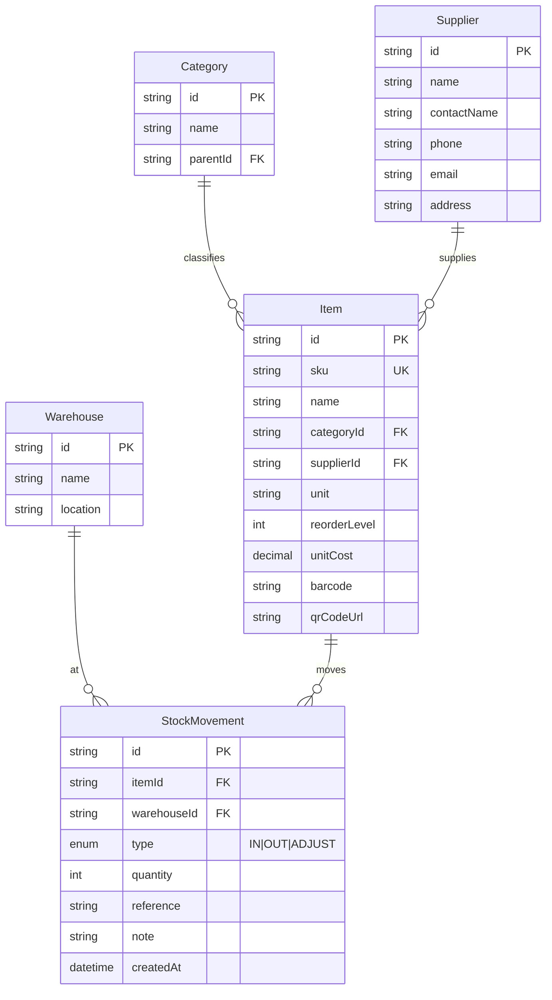
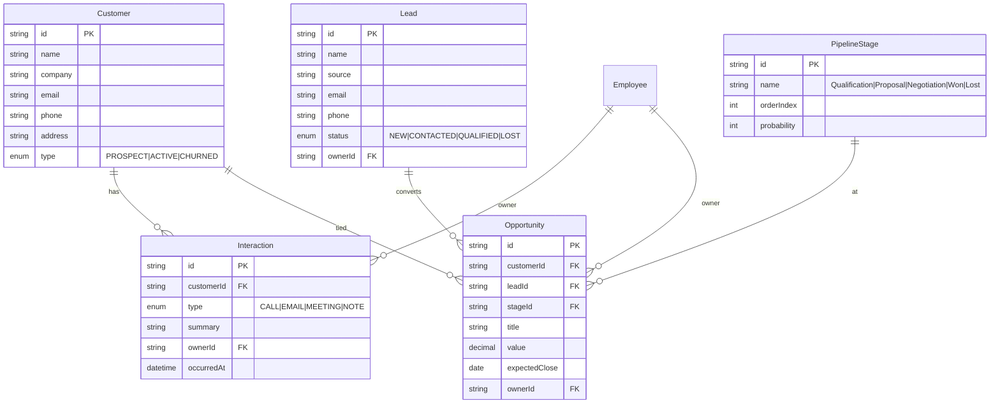
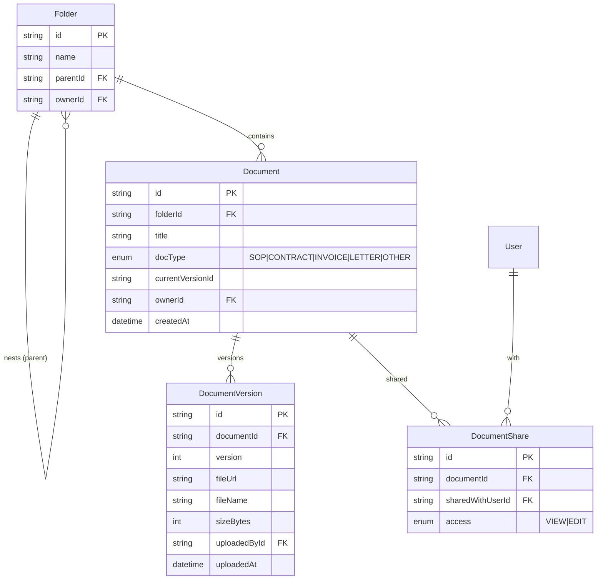
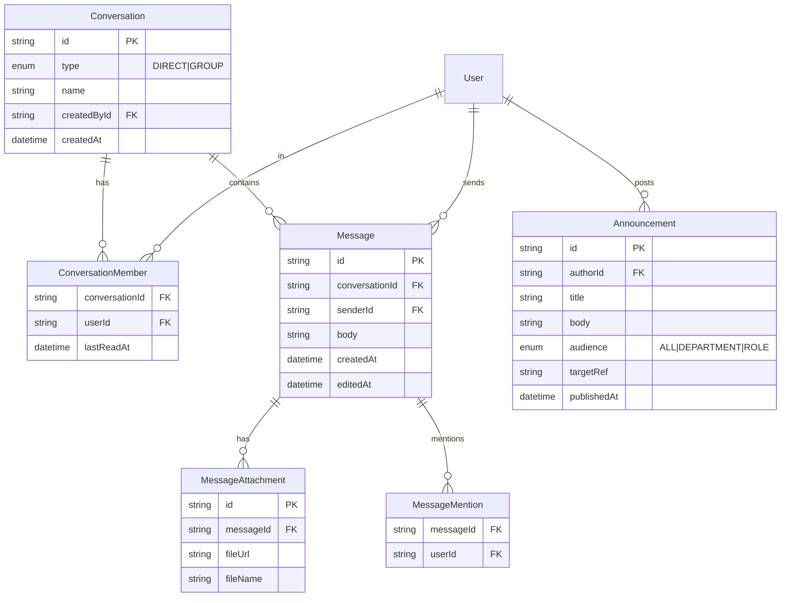

# Entity-Relationship Diagram (ERD)
### Nexus ECM · v1.0

Rendered with **Mermaid** (GitHub/VS Code render this natively). The model is split into domain
sub-diagrams for readability; relationships that cross domains are noted. The authoritative source of
truth is [`../packages/database/schema.prisma`](../packages/database/schema.prisma).

Legend: `||--o{` = one-to-many · `||--||` = one-to-one · `}o--o{` = many-to-many (via join table).

---

## 1. Identity, RBAC & Audit

---

## 2. Employee / HR

---

## 3. Attendance & Face Recognition

---

## 4. Leave Management

---

## 5. Projects & Tasks

---

## 6. Finance

---

## 7. Inventory

---

## 8. CRM

---

## 9. Documents

---

## 10. Internal Communication

---

## Cross-domain relationships (summary)
- `User 1—1 Employee` (an Employee may have a login account).
- `Employee` appears as actor across Attendance, Leave, Projects, Tasks, Finance (reimbursement), CRM (owner).
- `AuditLog.actorId → User` captures every mutating action across all modules.
- `Notification.userId → User` is the sink for all module events.
- File URLs (`*Url`) across modules point to objects in **MinIO**; access via presigned URLs.
